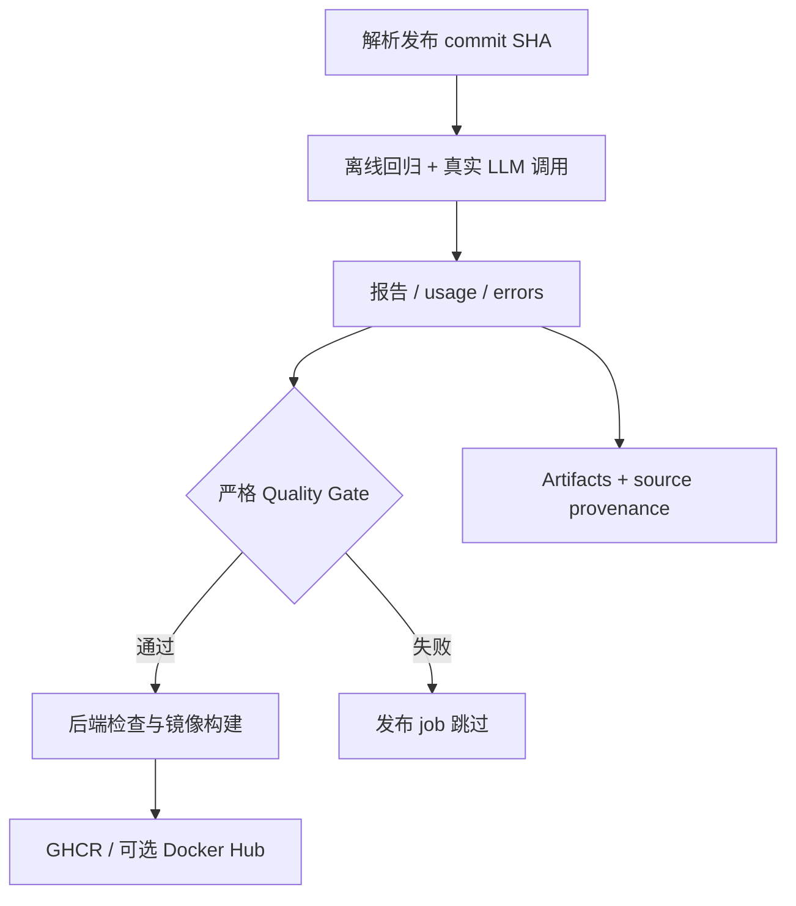

# LLMOps Portfolio: Report Quality → Release Gate

基于 [ZhuLinsen/daily_stock_analysis](https://github.com/ZhuLinsen/daily_stock_analysis) 的个人工程扩展。原项目提供股票分析应用；本 fork 的展示重点是 **LLM 输出评测、token/费用观测、错误处理和镜像发布门禁**，不把上游完整应用视为个人从零开发成果。

| 工程问题 | 本 fork 的实现 | 证据与边界 |
| --- | --- | --- |
| LLM 返回 JSON，但字段/数据错误 | 共享严格校验、20 个合成 fixture、真实调用 runner | [真实小样本通过记录](https://github.com/Atlas-Schulter/daily_stock_analysis/actions/runs/40408110412)，不是投资正确性评估 |
| 无效输出仍消耗 token | 先保存 usage，再解析；未知价格不记为零成本 | [评测代码](benchmarks/live_v2.py)、离线回归测试 |
| 质量检查与发布脱节 | 两条主应用镜像流水线通过 `needs` 依赖真实 LLM Gate | [发布说明与证据](docs/LLMOPS_RELEASE.md)，不等于生产部署门禁 |
| 无法复核发布检查的版本 | Gate 与 Docker 使用同一 commit SHA，保存 provenance 和 artifacts | release artifact 包含 source SHA、模型、运行 ID 与检查结果 |



**快速验证（无 API 费用）：**

```bash
python -m pip install 'PyYAML>=6,<7'
python -m unittest discover -s tests -p 'test_live*.py' -v
python -m unittest discover -s tests -p 'test_benchmark_v2.py' -v
python -m unittest discover -s tests -p 'test_quality_gate.py' -v
python -m unittest discover -s tests -p 'test_release_gate.py' -v
```

**范围：**发布 Gate 默认 Gemini、每模型 2 个案例、最多 6 次调用，要求 100% 通过；触发发布会消耗 API 用量。模型可通过 Repository Variable `RELEASE_LLM_MODELS` 指定。当前评测是合成数据保真度检查，不是主应用端到端质量认证。已核对 [v2.1.0 真实 GHCR 发布记录](https://github.com/Atlas-Schulter/daily_stock_analysis/actions/runs/40529687538)：真实 LLM Gate、backend gate、Docker smoke 和镜像推送均通过；后续 [v2.1.1 发布](https://github.com/Atlas-Schulter/daily_stock_analysis/actions/runs/40571513998) 已完成按 digest 拉取和容器核心模块导入 smoke；FastAPI/HTTP 健康检查与生产部署仍未验证。详见 [架构、证据、运行及回滚](docs/LLMOPS_RELEASE.md)。


## Upstream application guide

股票应用的安装、使用与完整功能请查看 [upstream README](https://github.com/ZhuLinsen/daily_stock_analysis#readme)。本 fork 保留上游代码与许可证，本文聚焦新增 LLMOps 工程。

[English portfolio overview](docs/README_EN.md) · [MIT license](LICENSE)

## 已验证发布与演示

- **真实发布：** [Docker Publish #40529687538](https://github.com/Atlas-Schulter/daily_stock_analysis/actions/runs/40529687538)，2026-10-27 手动触发，三个 job 均通过。
- **模型质量：** Gemini 2.5 Flash，两例均通过，零错误；这是发布 smoke sample，不是全部 20 例评测。
- **代码版本：** `v2.1.0` → `49bd537335c4d874d194d27cd3e1dc3f566993b1`；Workflow 启动版本与待发布源码可以不同，以 provenance 为准。
- **镜像：** `ghcr.io/atlas-schulter/daily_stock_analysis:v2.1.0`；不可变 digest 见 [发布证据](docs/LLMOPS_RELEASE.md#verified-release-v210)。
- **阻断证据：** [错误报告演练](https://github.com/Atlas-Schulter/daily_stock_analysis/actions/runs/40476357498) 中错误 Gate 失败，依赖它的标记 job 跳过。
- **面试演示：** [3 分钟操作路线、讲稿与追问](docs/DEMO_WALKTHROUGH.md)。原始 Gate 文件已归档到 [evidence/release-v2.1.0](docs/evidence/release-v2.1.0/)，避免仅依赖临时 Actions artifacts。

## 发布后验收（v2.1.1）

[Docker Publish #40571513998](https://github.com/Atlas-Schulter/daily_stock_analysis/actions/runs/40571513998) 已通过真实 LLM Gate、后端检查、镜像推送及 `Verify published GHCR image`。源码为 `3c97bd2fcb89fb62e07f9d8e8895a4aefd4f8dca`。

发布后的步骤用构建输出 digest 从 GHCR 拉取同一镜像，覆盖默认 entrypoint，运行 Python 导入 config/storage/analyzer/notification 核心模块，输出 `Post-release verification passed`。这证明已发布镜像的拉取与导入 smoke 成功；没有启动 FastAPI 或调用 HTTP 健康接口。

镜像：`ghcr.io/atlas-schulter/daily_stock_analysis:v2.1.1`；digest：`sha256:5b48240e2f5c2c3690b518b3cca9f316bd3b7478b9694e6f9abcfda29ac90571`。详见 [最新验收证据](docs/LLMOPS_RELEASE.md#verified-post-release-v211)。

## P1–P3 计划验收

原始基础目标已完成，见 [可勾选进度表](docs/PROJECT_PROGRESS.md)。P3 的部署证据来自 [Risk Alert 定时容器运行](https://github.com/Atlas-Schulter/daily_stock_analysis/actions/runs/40457981665)：真实行情 3 只、数据错误 0、任务成功。此次没有触发风险，通知数为 0；真实 Discord 送达未由本次运行验证。它是独立 risk-alert 镜像的批处理部署，不是 FastAPI 或长期生产服务部署。
