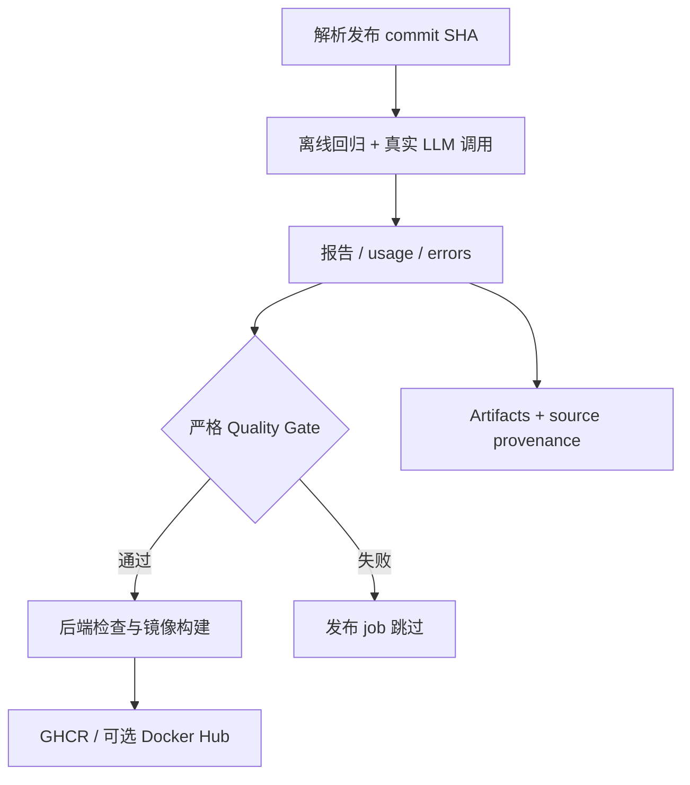

# LLMOps Portfolio: Report Quality → Release Gate

基于 [ZhuLinsen/daily_stock_analysis](https://github.com/ZhuLinsen/daily_stock_analysis) 的个人工程扩展。原项目提供股票分析应用；本 fork 的展示重点是 **LLM 输出评测、token/费用观测、错误处理和镜像发布门禁**，不把上游完整应用视为个人从零开发成果。

| 工程问题 | 本 fork 的实现 | 证据与边界 |
| --- | --- | --- |
| LLM 返回 JSON，但字段/数据错误 | 共享严格校验、20 个合成 fixture、真实调用 runner | [真实小样本通过记录](https://github.com/Atlas-Schulter/daily_stock_analysis/actions/runs/40408110412)，不是投资正确性评估 |
| 无效输出仍消耗 token | 先保存 usage，再解析；未知价格不记为零成本 | [评测代码](benchmarks/live_v2.py)、离线回归测试 |
| 质量检查与发布脱节 | 两条主应用镜像流水线通过 `needs` 依赖真实 LLM Gate | [发布说明与证据](docs/LLMOPS_RELEASE.md)，不等于生产部署门禁 |
| 无法复核发布检查的版本 | Gate 与 Docker 使用同一 commit SHA，保存 provenance 和 artifacts | release artifact 包含 source SHA、模型、运行 ID 与检查结果 |



**快速验证（无 API 费用）：**

```bash
python -m pip install 'PyYAML>=6,<7'
python -m unittest discover -s tests -p 'test_live*.py' -v
python -m unittest discover -s tests -p 'test_benchmark_v2.py' -v
python -m unittest discover -s tests -p 'test_quality_gate.py' -v
python -m unittest discover -s tests -p 'test_release_gate.py' -v
```

**范围：**发布 Gate 默认 Gemini、每模型 2 个案例、最多 6 次调用，要求 100% 通过；触发发布会消耗 API 用量。模型可通过 Repository Variable `RELEASE_LLM_MODELS` 指定。当前评测是合成数据保真度检查，不是主应用端到端质量认证。无真实 GHCR 发布验证时，不声称已成功发布镜像。详见 [架构、证据、运行及回滚](docs/LLMOPS_RELEASE.md)。


## Upstream application guide

股票应用的安装、使用与完整功能请查看 [upstream README](https://github.com/ZhuLinsen/daily_stock_analysis#readme)。本 fork 保留上游代码与许可证，本文聚焦新增 LLMOps 工程。

[English portfolio overview](docs/README_EN.md) · [MIT license](LICENSE)
