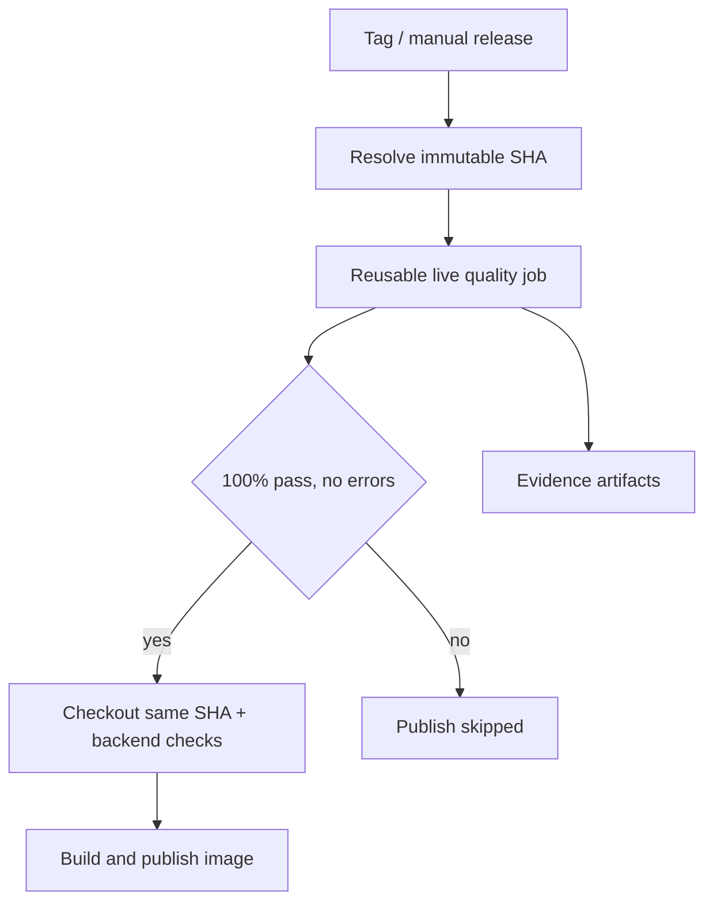

# LLM report quality and image release / 质量与镜像发布

## Scope and ownership

The application is an upstream fork. Portfolio contributions here are the benchmark runner, shared strict validation, usage/cost accounting, workflow integration, and evidence. This benchmark uses a dedicated synthetic-data prompt, not the production analysis prompt; passing it cannot certify production report quality, investment returns, or narrative factuality.

## Architecture and release policy

1. `docker-publish.yml`: tag push or manual `release_tag`; resolve an annotated `vX.Y.Z` tag once to an immutable commit SHA. The gate and Docker checkout use this same SHA. Existing backend gate and Docker smoke checks remain before push. SHA image tags identify the resolved release source, not the branch used to dispatch the workflow.
2. `ghcr-dockerhub.yml`: manual publication of the selected event SHA; the same source is evaluated and built. Both GHCR and Docker Hub publication wait for the gate.
3. `llm-release-gate.yml`: reusable workflow with read-only permissions. Run offline regressions, invoke real models, enforce `--min-pass-rate 1.0`, and upload JSONL, comparison, gate result and `release_provenance.json`, including on failure.
4. Publication jobs retain registry write permission; `needs: llm-quality` prevents them from starting after failure or cancellation. There is no mock mode, bypass input, `always()` publication job, or `continue-on-error` on the release gate.

The independent `risk-alert-container.yml`, `risk-alert-deploy.yml`, GitHub Release notes, and desktop distribution are outside this gate. Old workflow revisions/tags, direct registry writes, and administrator changes are not prevented by this repository-level wiring. This is not a registry-wide security policy or production deployment control.

## Configuration and cost

- Repository Variable `RELEASE_LLM_MODELS`: comma-separated LiteLLM model IDs; default `gemini/gemini-2.5-flash`.
- Provider Secrets: `GEMINI`, `AIHUBMIX_API_KEY`, `OPENAI_API_KEY`, `ANTHROPIC_API_KEY`, as applicable. Never put key values in repository files.
- Two cases per model, at most six planned calls, no retries, five-second spacing, 20-minute job timeout. More than three models fails before calling APIs. Old tags without the benchmark implementation fail closed.
- Missing keys, quotas, unavailable providers, invalid JSON, missing usage, incorrect fields, and skipped requests block release. Unknown pricing is allowed; costs remain explicitly unknown.
- Calls are real and can incur cost when you trigger these release workflows. Ordinary pushes run only offline checks and the no-publish rehearsal.
- Only the first two normal cases are the release smoke sample; run the 20-case Benchmark separately for broader coverage. No claim of comprehensive model validation.

## Rehearsal: success and deliberate failure

`release-gate-rehearsal.yml` uses the real quality-gate CLI with explicitly synthetic responses. It has no registry credentials or write permissions and does not build/publish images.

| Job | Expected result | Meaning |
| --- | --- | --- |
| regression | success | Publisher dependency/source wiring and CLI exit tests |
| valid-gate | success | Exact fixture observations accepted |
| allowed-publish-marker | success | Dependency permits a harmless marker |
| invalid-gate | failure | Incorrect close is rejected (`mismatch:close`) |
| blocked-publish-marker | skipped | Failed gate prevents dependent job from running |
| verify-dependencies | success | GitHub outcomes match the expected pattern |

**The overall rehearsal run is intentionally red because its negative job fails.** Check `verify-dependencies` and the skipped marker to judge the experiment. A green run alone would not demonstrate negative blocking. It is not an actual image publication test.

## Evidence ledger

| Evidence | Result / limitation |
| --- | --- |
| [Live Gemini gate before prompt repair](https://github.com/Atlas-Schulter/daily_stock_analysis/actions/runs/40407036620) | Two API responses returned incorrect observation types; gate failed |
| [Live Gemini gate after prompt v2.1](https://github.com/Atlas-Schulter/daily_stock_analysis/actions/runs/40408110412) | Successful manual run; small synthetic sample only |
| Local release regression | Four tests cover both publisher dependencies, same-source checkout, mandatory real gate, valid/invalid CLI outcomes, and absence of rehearsal publishing |
| [No-publish rehearsal runs](https://github.com/Atlas-Schulter/daily_stock_analysis/actions/workflows/release-gate-rehearsal.yml) | Specific run and observed outcomes to be recorded after integration |
| Actual GHCR publication with gate | Not executed in this integration; do not claim a proven successful push |
| Production deployment gating | Not implemented by this change |

## Run and inspect

For an offline local check, use the commands in the root README. For the dependency rehearsal, use Actions → Release Gate Rehearsal (no publish) → Run workflow, or a matching push. Download the two rehearsal artifacts to inspect `quality_gate.json`.

For an intended real image release, use an annotated tag created from an integrated revision, configure the provider Secret, and trigger Docker Publish with that tag. Both the live gate and existing backend/build checks must pass before registry writes. Do not use a real release merely to rehearse failure.

A previous green Quality Gate run is not reused as release approval: every release gate evaluates the exact source being built. Re-running an old run uses its old workflow/code; dispatch a new run for a new revision.

## Rollback and limitations

Revert the integration commit to restore previous workflow behavior; this also removes the release block and must be described explicitly. No image was published by the rehearsal, so no registry rollback is needed. Real provider compatibility, billing, full backend integration, Docker build/push and production deployment are distinct verification layers. Dependencies remain version ranges, so the runtime environment is not fully reproducible.

中文版要点：本次实现的是两条主应用镜像发布流水线的质量依赖；演练用合成报告验证通过和阻断，不实际发布镜像。真实 Gemini 小样本已有成功记录，但尚无此次集成后真实 GHCR 发布证据。独立 risk-alert、桌面发行、生产部署和旧 Workflow 不在覆盖范围内。
