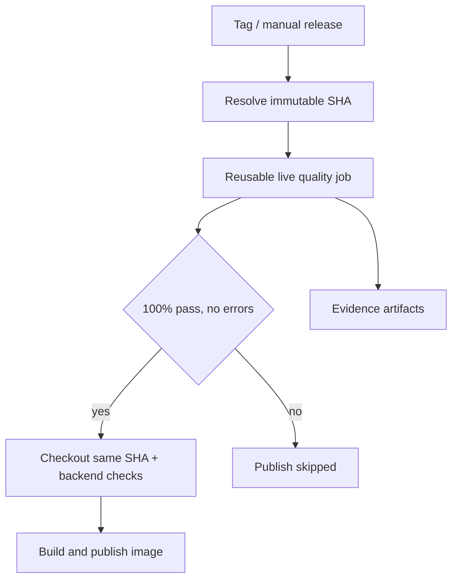

# LLM report quality and image release / 质量与镜像发布

## Scope and ownership

The application is an upstream fork. Portfolio contributions here are the benchmark runner, shared strict validation, usage/cost accounting, workflow integration, and evidence. This benchmark uses a dedicated synthetic-data prompt, not the production analysis prompt; passing it cannot certify production report quality, investment returns, or narrative factuality.

## Architecture and release policy

1. `docker-publish.yml`: tag push or manual `release_tag`; resolve an annotated `vX.Y.Z` tag once to an immutable commit SHA. The gate and Docker checkout use this same SHA. Existing backend gate and Docker smoke checks remain before push. SHA image tags identify the resolved release source, not the branch used to dispatch the workflow.
2. `ghcr-dockerhub.yml`: manual publication of the selected event SHA; the same source is evaluated and built. Both GHCR and Docker Hub publication wait for the gate.
3. `llm-release-gate.yml`: reusable workflow with read-only permissions. Run offline regressions, invoke real models, enforce `--min-pass-rate 1.0`, and upload JSONL, comparison, gate result and `release_provenance.json`, including on failure.
4. Publication jobs retain registry write permission; `needs: llm-quality` prevents them from starting after failure or cancellation. There is no mock mode, bypass input, `always()` publication job, or `continue-on-error` on the release gate.

The independent `risk-alert-container.yml`, `risk-alert-deploy.yml`, GitHub Release notes, and desktop distribution are outside this gate. Old workflow revisions/tags, direct registry writes, and administrator changes are not prevented by this repository-level wiring. This is not a registry-wide security policy or production deployment control.

## Configuration and cost

- Repository Variable `RELEASE_LLM_MODELS`: comma-separated LiteLLM model IDs; default `gemini/gemini-2.5-flash`.
- Provider Secrets: `GEMINI`, `AIHUBMIX_API_KEY`, `OPENAI_API_KEY`, `ANTHROPIC_API_KEY`, as applicable. Never put key values in repository files.
- Two cases per model, at most six planned calls, no retries, five-second spacing, 20-minute job timeout. More than three models fails before calling APIs. Old tags without the benchmark implementation fail closed.
- Missing keys, quotas, unavailable providers, invalid JSON, missing usage, incorrect fields, and skipped requests block release. Unknown pricing is allowed; costs remain explicitly unknown.
- Calls are real and can incur cost when you trigger these release workflows. Ordinary pushes run only offline checks and the no-publish rehearsal.
- Only the first two fixture cases are the release smoke sample; run the 20-case Benchmark separately for broader coverage. No claim of comprehensive model validation.

## Rehearsal: success and deliberate failure

`release-gate-rehearsal.yml` uses the real quality-gate CLI with explicitly synthetic responses. It has no registry credentials or write permissions and does not build/publish images.

| Job | Expected result | Meaning |
| --- | --- | --- |
| regression | success | Publisher dependency/source wiring and CLI exit tests |
| valid-gate | success | Exact fixture observations accepted |
| allowed-publish-marker | success | Dependency permits a harmless marker |
| invalid-gate | failure | Incorrect close is rejected (`mismatch:close`) |
| blocked-publish-marker | skipped | Failed gate prevents dependent job from running |
| verify-dependencies | success | GitHub outcomes match the expected pattern |

**The overall rehearsal run is intentionally red because its negative job fails.** Check `verify-dependencies` and the skipped marker to judge the experiment. A green run alone would not demonstrate negative blocking. It is not an actual image publication test.

## Evidence ledger

| Evidence | Result / limitation |
| --- | --- |
| [Live Gemini gate before prompt repair](https://github.com/Atlas-Schulter/daily_stock_analysis/actions/runs/40407036620) | Two API responses returned incorrect observation types; gate failed |
| [Live Gemini gate after prompt v2.1](https://github.com/Atlas-Schulter/daily_stock_analysis/actions/runs/40408110412) | Successful manual run; small synthetic sample only |
| Local release regression | Four tests cover both publisher dependencies, same-source checkout, mandatory real gate, valid/invalid CLI outcomes, and absence of rehearsal publishing |
| [No-publish rehearsal 40476357498](https://github.com/Atlas-Schulter/daily_stock_analysis/actions/runs/40476357498) | Observed: regression success; valid-gate success; allowed-publish-marker success; invalid-gate failure; blocked-publish-marker skipped; verify-dependencies success. Overall red is the expected negative-test result. |
| [Actual GHCR publication with gate](https://github.com/Atlas-Schulter/daily_stock_analysis/actions/runs/40529687538) | Verified v2.1.0: resolve-source, real LLM Gate and build-and-push all succeeded; immutable artifact details below |
| Production deployment gating | Not implemented by this change |

## Run and inspect

For an offline local check, use the commands in the root README. For the dependency rehearsal, use Actions → Release Gate Rehearsal (no publish) → Run workflow, or a matching push. Download the two rehearsal artifacts to inspect `quality_gate.json`.

For an intended real image release, use an annotated tag created from an integrated revision, configure the provider Secret, and trigger Docker Publish with that tag. Both the live gate and existing backend/build checks must pass before registry writes. Do not use a real release merely to rehearse failure.

A previous green Quality Gate run is not reused as release approval: every release gate evaluates the exact source being built. Re-running an old run uses its old workflow/code; dispatch a new run for a new revision.

## Rollback and limitations

Revert the integration commit to restore previous workflow behavior; this also removes the release block and must be described explicitly. No image was published by the rehearsal, so no registry rollback is needed. Real provider compatibility, billing, full backend integration, Docker build/push and production deployment are distinct verification layers. Dependencies remain version ranges, so the runtime environment is not fully reproducible.

中文版要点：本次实现的是两条主应用镜像发布流水线的质量依赖；演练用合成报告验证通过和阻断，不实际发布镜像。真实 Gemini 小样本已有成功记录，现已核对 v2.1.0 真实 GHCR 发布成功记录；后续 v2.1.1 已完成按 digest 拉取及容器核心模块导入 smoke；FastAPI 启动、HTTP 健康检查和生产部署仍未验证。独立 risk-alert、桌面发行、生产部署和旧 Workflow 不在覆盖范围内。

## Integration change record

- Integrated commit: `4efcd112cdc189a1f193c6a6cb487989c8cc3feb`.
- 两条主应用发布入口接入同 SHA 的真实 LLM Gate；现有 backend / Docker smoke 保留。
- 中文注释补充到发布 Workflow、演练脚本与测试；中英文项目首页统一为作品说明，原应用指南链接至上游。
- Local: 4 release regression tests and 6 quality-gate tests passed; Python compilation, YAML parsing and embedded Bash syntax checks passed.
- Remote: [positive/negative dependency evidence](https://github.com/Atlas-Schulter/daily_stock_analysis/actions/runs/40476357498). The negative job rejected incorrect close values; its dependent marker was skipped.
- No paid API calls or image registry writes were performed for this rehearsal. The release jobs will make real API calls when explicitly triggered.

## Verified release v2.1.0

Evidence checked on 2026-10-27. Values below come from the Actions job logs and original artifact, not inferred from the green run icon.

| Field | Verified value |
| --- | --- |
| Workflow run | [40529687538, attempt 1](https://github.com/Atlas-Schulter/daily_stock_analysis/actions/runs/40529687538) |
| Trigger / workflow revision | `workflow_dispatch` on main, `fdf83f51e50378a2bd3829c644c75185c0785815` |
| Release tag / checked and built source | `v2.1.0` / `49bd537335c4d874d194d27cd3e1dc3f566993b1` |
| Model | `gemini/gemini-2.5-flash` |
| Live Gate | `passed=true`, `quality_passed_pairs=2`, `expected_pairs=2`, `pass_rate=1.0`, `error_rows=0` |
| Jobs | `resolve-source`, `llm-quality / quality`, `build-and-push`: all success |
| Build checks | Backend gate and pre-publish Docker import smoke succeeded |
| Image | `ghcr.io/atlas-schulter/daily_stock_analysis` |
| Tags recorded in push logs | `v2.1.0`, `latest`, `sha-49bd537335c4d874d194d27cd3e1dc3f566993b1` |
| Manifest digest from build/push metadata | `sha256:7d43c6d5268dac73381aa2ff2106bd931231f6b954e6a7b8df7e7ba4a38abb36` |
| Original artifact | [12746235314](https://github.com/Atlas-Schulter/daily_stock_analysis/actions/runs/40529687538/artifacts/12746235314), Actions retention expires 2026-11-26 |
| Durable copy | [Original gate files](evidence/release-v2.1.0/) copied unchanged from the artifact |

The run's `head_sha` identifies the workflow revision. `release_provenance.json.source_sha` identifies the evaluated release source. These values differ by design in a manual tagged release. The source-SHA tag and metadata match the latter. Tags such as latest may move later; the recorded digest identifies this publication.

Original archived files: `quality_gate.json`, `release_provenance.json`, `benchmark_comparison.json`, `reports.jsonl`, `usage.jsonl`, and `errors.jsonl`. The empty errors file is intentional. [Archive README](evidence/release-v2.1.0/README.md) states provenance and scope.

### What this evidence establishes

- A real LLM release gate was followed by backend checks, a local Docker import smoke and a successful GHCR push for the same release source.
- The separate synthetic rehearsal proves a failing Gate prevents a dependent marker from running. It does not constitute an intentionally failed real registry publication attempt.
- Post-push pull/start acceptance, service health checks, production deployment, every provider, and all 20 fixtures are not covered by this run. Model pricing is not required by this gate; unknown pricing must not be described as a free call.

### Reproduce the presentation

Use [the three-minute walkthrough](DEMO_WALKTHROUGH.md). It uses saved evidence, requires no new paid calls, and does not publish another image. Documentation changes can be rolled back independently of release workflows.

## Verified post-release v2.1.1

Checked against the actual publish-job log on 2026-10-27. This supplements the historical v2.1.0 record above; the earlier run did not include this post-push step.

| Field | Observed evidence |
| --- | --- |
| Run | [40571513998](https://github.com/Atlas-Schulter/daily_stock_analysis/actions/runs/40571513998), success |
| Tag / source SHA | `v2.1.1` / `3c97bd2fcb89fb62e07f9d8e8895a4aefd4f8dca` |
| Real LLM Gate | Gemini 2.5 Flash, 2/2 cases, zero error rows |
| Publish / post-push step | `Publish Docker image to GHCR` and `Verify published GHCR image`: success |
| Published and pulled manifest digest | `sha256:5b48240e2f5c2c3690b518b3cca9f316bd3b7478b9694e6f9abcfda29ac90571` |
| Pull log | `Digest: sha256:5b48240e2f5c2c3690b518b3cca9f316bd3b7478b9694e6f9abcfda29ac90571`, followed by `Status: Downloaded newer image` |
| Container smoke | Python entrypoint imports config, storage, analyzer and notification; log prints `Post-release verification passed` |
| Completion | Log marker at 2026-10-27 19:48:50 UTC (20:48:50 Europe/Berlin) |
| Durable summary | [Verification snapshot](evidence/release-v2.1.1/post-release-verification.json), curated from the log, not an original Actions artifact |

The default application entrypoint was overridden with Python. No full FastAPI server startup, HTTP health/readiness check, functional analysis request or production deployment was performed by this step. Publication already occurred before verification; a failed post-push check would mark the workflow failed, not remove or roll back the published image automatically.

中文版：第一步已完成的范围是“同 digest 拉取 + 容器核心模块导入 smoke”，不是完整服务健康验收。文档更新不修改 Workflow，不重跑发布，也不改变原 v2.1.0 的归档证据。回滚本次文档提交不影响已发布镜像。
